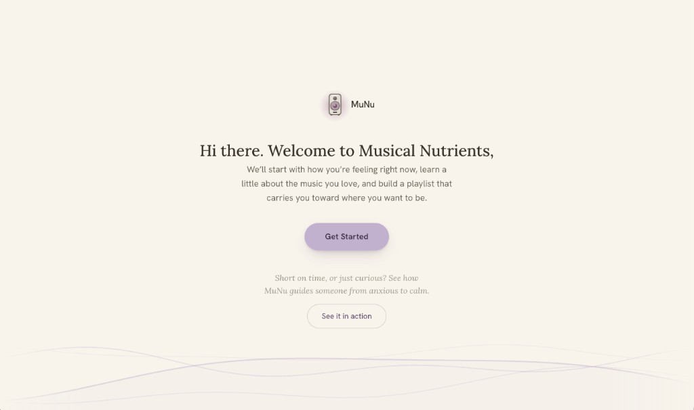

# Musical Nutrients (MuNu)

Mental health and music usually live in separate apps. Mindfulness tools offer calm soundscapes people rarely seek out when Spotify already plays music they love; Spotify can build a playlist but does not know what you are going through today. MuNu sits in between: it asks how you are feeling, learns your taste, and builds a playlist that moves you from where you are to where you want to be, using the ISO principle from music therapy.

**Live:** [musicalnutrients.com](https://musicalnutrients.com)

## What it does

A four-question check-in captures what is on your mind, what you have been listening to, your favorite genres, and how you want to feel afterward. Recent songs go through the ReccoBeats API for audio features (energy, valence, tempo, and related signals) so Claude works from how the music actually sounds, not just titles. Claude returns a short emotional insight and a sequenced playlist, with a note on why each track sits where it does. Tracks are resolved to real songs and played in order in an embedded YouTube player so the list works as a progression rather than a shuffle. A scripted demo persona (Vivi) shows the full flow without entering personal data.

## How it works

The React app is a two-stage flow: onboarding, then results. Progress and answers are kept in `localStorage`. Onboarding walks through welcome and prep screens, then four questions (mind, recent tracks via Spotify search, genres, desired feeling). Choosing the Vivi demo prefills that path and uses baked results instead of a live model call.

On results, recent Spotify track IDs are enriched through `/api/reccobeats`. `/api/claude` sends genres, the check-in text, recent tracks with audio features, and the desired feeling to Anthropic, and asks for JSON: an insight, an ISO explanation, and ten `journeySongs`. Each suggested track is verified against the Spotify catalog; non-matches are dropped. Surviving tracks get 30-second preview URLs from the iTunes Search API (proxied as `/itunes`), then video IDs from `/api/youtube-search`, which caches lookups in Supabase. When YouTube resolution succeeds, playback uses the embedded player in order; otherwise the UI falls back to the preview carousel.

## Tech stack

- React 19, TypeScript, Vite
- Tailwind CSS 4, Radix UI / shadcn components
- Vercel serverless functions (`/api`)
- Anthropic Claude (`claude-opus-4-7`) for insight + playlist generation
- Spotify Web API (client-credentials token + track search)
- ReccoBeats API for track audio features
- YouTube Data API for video resolution, with a Supabase `youtube_video_cache`
- iTunes Search API for 30-second preview URLs
- Vercel Analytics

## Key decisions and tradeoffs

- **Four questions, not eight.** Beta testers found the longer intake hard to answer on the spot. Kept only the inputs that change the playlist.
- **ReccoBeats audio features in the prompt.** Titles alone give Claude little to work with. Enriching recent tracks grounds the arc in the sonic profile of what the user already listens to.
- **Full YouTube player instead of preview-only carousel.** Testers wanted something playable inside Spotify or Apple Music. Spotify's developer mode caps apps at 5 users (extended access needs an established org), and Apple MusicKit needs a paid developer account plus a paid subscription per user. YouTube was the option with no user cap and full playback.
- **YouTube Data API quota is the main scaling limit.** Only a limited number of playlists can be built per day. If a playlist cannot be fully resolved, the app falls back to the preview carousel.
- **Shared Supabase video ID cache.** Repeat songs cost zero quota, and the cache gets more useful as more playlists are generated.
- **Spotify catalog verification.** LLM tracklists can include songs that do not exist. Every suggestion is checked against Spotify before it is added; non-matches are dropped.
- **Several APIs stitched together** (Claude, Spotify search, ReccoBeats, YouTube Data, iTunes previews) rather than depending on one platform, because no single platform allowed the full experience.

## What's next

- Save past playlists so a new check-in does not erase the last one
- Per-playlist feedback (did this actually shift how you felt?) that feeds future generations and decides which of the items below ships next
- Pull listening history from a streaming platform instead of asking, if access constraints allow it (currently blocked by Spotify's 5-user cap and its 25k monthly active user requirement for extended access)
- Apply for a higher YouTube Data API quota so the carousel fallback is rarely needed
